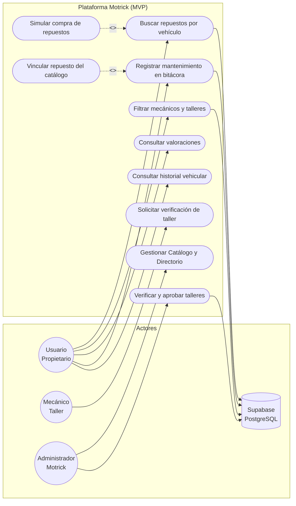
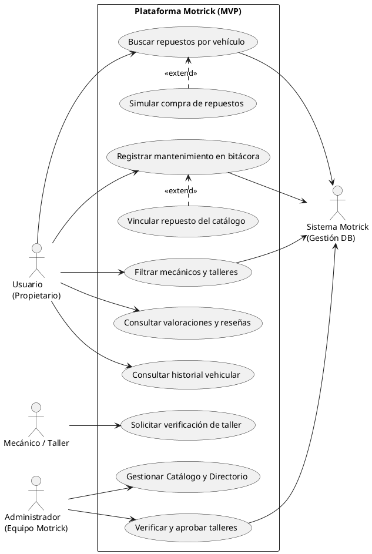
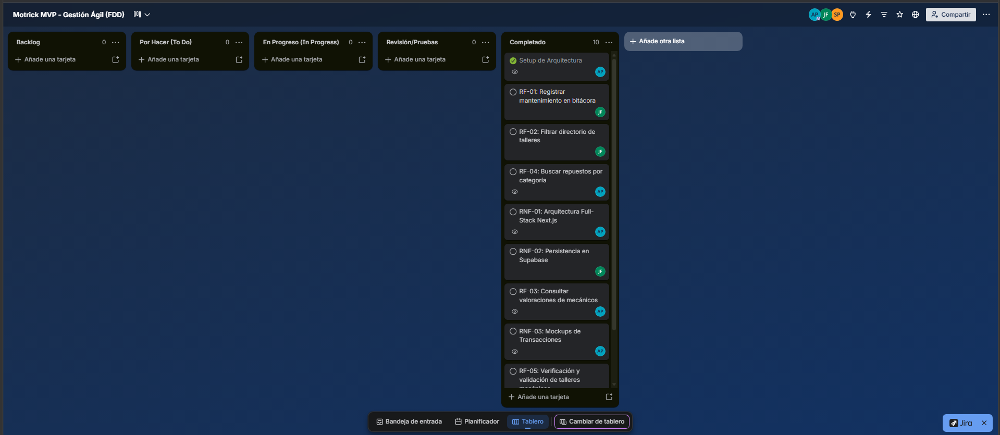

# UNIVERSIDAD TECNOLÓGICA DE BOLÍVAR
## FACULTAD DE INGENIERÍA
### PROGRAMA DE INGENIERÍA DE SOFTWARE
**GRUPO / CURSO:** 1208  
**PROYECTO DE AULA (TERCER CORTE - MVP FINAL)**  
**"Motrick: Plataforma Centralizada para la Gestión de Mantenimiento Vehicular, Directorio de Talleres y Catálogo de Repuestos"**  

**ESTUDIANTES:**  
* Alejandro David Paternina Bermejo – Código: T00078032  
* Johan Sebastian Brieva Fernandez – Código: T00077809  

**DOCENTE:**  
Aisner Jose Marrugo Juliao  

Cartagena de Indias, Bolívar  
2026  

---

# ÍNDICE GENERAL

1. [Capítulo 1: Marco de Negocio y Fundamentación Jurídica](#capítulo-1-marco-de-negocio-y-fundamentación-jurídica)  
   1.5. [Modelo de Negocio y Deslinde de Responsabilidad Legal (Ley 1480 de 2011)](#15-modelo-de-negocio-y-deslinde-de-responsabilidad-legal-ley-1480-de-2011)  
   1.5.2. [Publicidad Nativa Contextual y Política de Brand Safety (RNF-04)](#152-publicidad-nativa-contextual-y-política-de-brand-safety-rnf-04)  
2. [Capítulo 5: Especificación de Requerimientos de Software](#capítulo-5-especificación-de-requerimientos-de-software)  
   5.1. [Requerimientos Funcionales (RF-01 a RF-05)](#51-requerimientos-funcionales-rf-01-a-rf-05)  
   5.2. [Requerimientos No Funcionales (RNF-01 a RNF-04)](#52-requerimientos-no-funcionales-rnf-01-a-rnf-04)  
3. [Capítulo 7: Modelado UML y Matriz de Validación](#capítulo-7-modelado-uml-y-matriz-de-validación)  
   7.1. [Diagrama de Casos de Uso Actualizado (Figura 1)](#71-diagrama-de-casos-de-uso-actualizado-figura-1)  
   7.3. [Matriz de Validación y Ajustes Metodológicos](#73-matriz-de-validación-y-ajustes-metodológicos)  
4. [Capítulo 8: Gestión Ágil (FDD) y Control de Versiones](#capítulo-8-gestión-ágil-fdd-y-control-de-versiones)  
   8.1. [Tablero de Trabajo FDD (Figura 2)](#81-tablero-de-trabajo-fdd-figura-2)  
   8.2. [Repositorio, Ramas y Trazabilidad Git](#82-repositorio-ramas-y-trazabilidad-git)  
5. [Capítulo 9: Validación y Pruebas de Software (Evidencia Real)](#capítulo-9-validación-y-pruebas-de-software-evidencia-real)  
   9.1. [Reglas de Negocio Acordadas y Datos Base (seed.sql)](#91-reglas-de-negocio-acordadas-y-datos-base-seedsql)  
   9.2. [Matriz de Casos de Prueba Reales Ejecutados (Tabla 1)](#92-matriz-de-casos-de-prueba-reales-ejecutados-tabla-1)  
   9.3. [Registro y Corrección de Defectos (D1 y D2)](#93-registro-y-corrección-de-defectos-d1-y-d2)  
   9.4. [Simulación de Cambio y Pruebas de Regresión (Regla R6)](#94-simulación-de-cambio-y-pruebas-de-regresión-regla-r6)  
   9.5. [Revisión Cruzada y Decisión de Liberación](#95-revisión-cruzada-y-decisión-de-liberación)  

---

# Capítulo 1: Marco de Negocio y Fundamentación Jurídica

## 1.5. Modelo de Negocio y Deslinde de Responsabilidad Legal (Ley 1480 de 2011)

Motrick implementa un modelo de monetización B2B basado en membresías de visibilidad para talleres mecánicos y pauta publicitaria nativa, **descartando el cobro de comisiones sobre reparaciones**.

### Prevención de Solidaridad Jurídica
De acuerdo con el **Artículo 53 de la Ley 1480 de 2011 (Estatuto del Consumidor en Colombia)**, la plataforma califica como **portal de contacto e intermediación informativa**. Si Motrick recaudara el valor del servicio de mano de obra o comisionara sobre el arreglo mecánico, la Superintendencia de Industria y Comercio (SIC) la consideraría prestador solidario, debiendo responder económicamente ante fallas mecánicas, averías colaterales o garantías no atendidas por el taller. 

Al limitar los ingresos al canon de visibilidad y verificación, la relación contractual por el servicio automotriz se suscribe directa y exclusivamente entre el propietario del vehículo y el taller mecánico contratado.

> **Cláusula de Deslinde en Términos y Condiciones:**  
> *"Motrick opera bajo la figura de portal de contacto (Art. 53, Ley 1480 de 2011). La plataforma no ejecuta diagnósticos mecánicos, no provee mano de obra ni actúa como garante solidario de los trabajos realizados por los talleres listados. La contratación de servicios automotrices, su calidad y cumplimiento de garantías recaen exclusivamente en el establecimiento seleccionado por el usuario."*

---

## 1.5.2. Publicidad Nativa Contextual y Política de Brand Safety (RNF-04)

Como línea secundaria de sostenimiento, se habilitan espacios pasivos en los márgenes y zonas blancas de la interfaz, alineados con los **Artículos 29 y 30 de la Ley 1480 de 2011 (protección contra publicidad engañosa)**:

1. **Relevancia temático-vehicular:** Solo se admiten anunciantes de servicios afines (SOAT digital, revisión técnico-mecánica en Centros de Diagnóstico Automotor CDA aliados, escáneres OBD2 y telepeaje).
2. **Cero intrusión (UX):** Se vetan terminantemente pop-ups, modales bloqueantes o banners con audio automático, garantizando cero desplazamiento visual (*Cumulative Layout Shift = 0*).
3. **Seguridad de marca (Brand Safety):** Quedan prohibidos juegos móviles, apuestas deportivas, esquemas de inversión y contenido adulto (+18). Toda inserción cuenta con el distintivo gráfico visible y obligatorio **"Patrocinado"**.

---

# Capítulo 5: Especificación de Requerimientos de Software

## 5.1. Requerimientos Funcionales (RF-01 a RF-05)

### Ficha Técnica: RF-01
| Campo | Detalle Técnico |
| :--- | :--- |
| **Identificador** | **RF-01** |
| **Nombre** | Registro y control de mantenimiento en bitácora vehicular |
| **Descripción** | El sistema debe permitir a los usuarios propietarios registrar mantenimientos preventivos o correctivos de sus vehículos, capturando fecha, odómetro, título del servicio, notas adicionales, taller ejecutor y repuesto asociado. |
| **Fuente** | Elicitación: Entrevistas a conductores y análisis de gestión de flotas particulares. |
| **Prioridad** | Alta |
| **Criterio de Aceptación** | El registro se almacena en la tabla `registros_bitacora` de Supabase vinculándose al vehículo activo. Si el odómetro ingresado es menor al kilometraje registrado del vehículo, la interfaz rechaza la operación. |

### Ficha Técnica: RF-02
| Campo | Detalle Técnico |
| :--- | :--- |
| **Identificador** | **RF-02** |
| **Nombre** | Directorio de talleres mecánicos con filtros de especialidad |
| **Descripción** | La plataforma debe presentar un directorio interactivo de establecimientos mecánicos, permitiendo filtrar por especialidad técnica (Frenos, Motor, Suspensión, Transmisión, Eléctrico), calificación promedio y estado de verificación. |
| **Fuente** | Elicitación: Necesidad de localización rápida de talleres especializados en Bogotá. |
| **Prioridad** | Alta |
| **Criterio de Aceptación** | La consulta PostgREST a `mecanicos` filtra dinámicamente mediante `ILIKE` sobre la columna `especialidad` y actualiza la cuadrícula de talleres en tiempo real. |

### Ficha Técnica: RF-03
| Campo | Detalle Técnico |
| :--- | :--- |
| **Identificador** | **RF-03** |
| **Nombre** | Consulta de valoraciones y reseñas de mecánicos |
| **Descripción** | El sistema debe desplegar las calificaciones (1 a 5 estrellas) y opiniones otorgadas por clientes verificados a cada taller, calculando la nota promedio visible. |
| **Fuente** | Elicitación: Mitigación de asimetría informativa y desconfianza en talleres mecánicos. |
| **Prioridad** | Media / Alta |
| **Criterio de Aceptación** | Las valoraciones se recuperan de la tabla `valoraciones`. El motor de PostgreSQL impone restricción de dominio `CHECK (puntuacion >= 1 AND puntuacion <= 5)`. |

### Ficha Técnica: RF-04
| Campo | Detalle Técnico |
| :--- | :--- |
| **Identificador** | **RF-04** |
| **Nombre** | Catálogo de repuestos con filtro de compatibilidad vehicular |
| **Descripción** | El sistema debe ofrecer un catálogo de piezas automotrices categorizadas, señalando mediante un badge gráfico si el repuesto es compatible con el vehículo seleccionado por el usuario. |
| **Fuente** | Elicitación: Reducción del error en compras de repuestos automotrices incompatibles. |
| **Prioridad** | Alta |
| **Criterio de Aceptación** | El catálogo consulta la tabla `repuestos` en Supabase y compara la columna `compatibilidad` con el modelo y marca del vehículo activo. |

### Ficha Técnica: RF-05
| Campo | Detalle Técnico |
| :--- | :--- |
| **Identificador** | **RF-05** |
| **Nombre** | Verificación y validación de talleres mecánicos |
| **Descripción** | El sistema debe disponer de un canal para que los talleres soliciten una insignia de acreditación suministrando NIT/RUT, razón social, dirección física y teléfono de contacto. El Administrador valida la autenticidad de los datos para otorgar la insignia de taller verificado, y el directorio permite filtrar según este criterio. |
| **Fuente** | Elicitación: Mitigación de desconfianza del usuario (Estudio AAA) y modelo de membresías B2B. |
| **Prioridad** | Media |
| **Criterio de Aceptación** | El perfil del taller en `/directorio` muestra la insignia gráfica tras su confirmación en base de datos, y el filtro "Solo verificados" actualiza el listado en tiempo real. |

---

## 5.2. Requerimientos No Funcionales (RNF-01 a RNF-04)

### Ficha Técnica: RNF-01
| Campo | Detalle Técnico |
| :--- | :--- |
| **Identificador** | **RNF-01** |
| **Nombre** | Arquitectura Full-Stack Next.js y Modern UX |
| **Descripción** | La aplicación debe construirse sobre Next.js 14 con App Router, React 18 y TypeScript estricto, empleando Tailwind CSS para estilos con soporte nativo de tema oscuro/claro y componentes accesibles (Radix UI). |
| **Fuente** | Definición de Arquitectura y Estándares de Rendimiento Web. |
| **Prioridad** | Alta |
| **Criterio de Aceptación** | Compilación de producción (`npm run build`) con 0 advertencias de tipado estricto y rutas estáticas pre-renderizadas. |

### Ficha Técnica: RNF-02
| Campo | Detalle Técnico |
| :--- | :--- |
| **Identificador** | **RNF-02** |
| **Nombre** | Persistencia y Base de Datos en Supabase con Row-Level Security (RLS) |
| **Descripción** | El sistema debe almacenar la información en un motor relacional PostgreSQL alojado en Supabase, implementando políticas de seguridad a nivel de fila (RLS) para proteger los datos privados de usuarios y vehículos. |
| **Fuente** | Estándar de Seguridad y Persistencia en la Nube. |
| **Prioridad** | Alta |
| **Criterio de Aceptación** | Las tablas poseen RLS habilitado. Consultas anónimas solo acceden a datos públicos (catálogo, talleres aprobados), mientras bitácora y vehículos requieren contexto de propiedad. |

### Ficha Técnica: RNF-03
| Campo | Detalle Técnico |
| :--- | :--- |
| **Identificador** | **RNF-03** |
| **Nombre** | Pasarela y flujo simulado de pago (Checkout Seguro) |
| **Descripción** | El módulo de compra de repuestos debe proveer un asistente de pago en 4 pasos (Resumen, Tarjeta, Procesamiento y Comprobante) con animación 3D de tarjeta interactiva, sin procesar transacciones bancarias reales. |
| **Fuente** | Alcance de MVP y requerimiento de experiencia de usuario segura. |
| **Prioridad** | Media |
| **Criterio de Aceptación** | La interfaz exige exactamente 16 dígitos de tarjeta y 3 dígitos de CVV, generando una orden ficticia (MT-XXXXXX) sin almacenar datos sensibles de tarjetas de crédito. |

### Ficha Técnica: RNF-04
| Campo | Detalle Técnico |
| :--- | :--- |
| **Identificador** | **RNF-04** |
| **Nombre** | Visualización de publicidad nativa y contextual no invasiva |
| **Descripción** | La interfaz debe desplegar inserciones publicitarias pasivas integradas orgánicamente en el diseño (componente `SponsoredCard`) para servicios vehiculares aliados, con la etiqueta "Patrocinado" y sin recurrir a ventanas emergentes. |
| **Fuente** | Modelo de negocio de la plataforma y atributos de usabilidad (UX). |
| **Prioridad** | Baja / Media |
| **Criterio de Aceptación** | Las tarjetas respetan los tokens cromáticos de Tailwind CSS en temas claro y oscuro, sin interferir en los formularios ni generar redirecciones automáticas. |

---

# Capítulo 7: Modelado UML y Matriz de Validación

## 7.1. Diagrama de Casos de Uso Actualizado (Figura 1)



### Especificación PlantUML del Diagrama de Casos de Uso


**Figura 1**  
*Diagrama de Casos de Uso Actualizado con Módulo de Verificación y Rol Administrador*  
*Nota.* Elaboración propia (2026) basada en los requerimientos del MVP de Motrick, incorporando relaciones `<<extend>>` para el checkout y la vinculación de piezas, e interacciones del actor Administrador y Mecánico bajo la Ley 1480 de 2011.

---

## 7.3. Matriz de Validación y Ajustes Metodológicos

| Elemento revisado | Concepción inicial | Hallazgo de la elicitación / Negocio | Cambio realizado o justificación |
| :--- | :--- | :--- | :--- |
| **Casos de Uso (Directorio y Seguridad)** | Búsqueda pasiva de talleres sin proceso de acreditación de identidad comercial. | Alto porcentaje de desconfianza en talleres mecánicos (estudio AAA, 2016) y necesidad de exención de garantía solidaria (Ley 1480/2011). | Se crearon los casos de uso *Solicitar verificación de taller* (Mecánico) y *Verificar y aprobar talleres* (Administrador), formalizando el esquema de confianza y membresía sin asumir responsabilidad civil sobre reparaciones. |
| **Modelo de Monetización y Publicidad** | La plataforma no contemplaba monetización secundaria ni reglas de pauta publicitaria. | Necesidad de ingresos sostenibles sin comprometer la velocidad ni la seriedad técnica de la herramienta automotriz. | Se definió la publicidad nativa contextual (RNF-04) con política de Brand Safety (veto de juegos, apuestas y +18) y tag visible "Patrocinado" exigido por la SIC. |
| **Checkout de Repuestos** | Simulación simple con formulario genérico sin retroalimentación visual. | Altos índices de abandono de carritos en comercio electrónico y temor del usuario al ingreso de tarjetas. | Se implementó la tarjeta animada interactiva con giro 3D (Framer Motion) y validación estricta de 16 dígitos y CVV de 3 dígitos (RNF-03). |

---

# Capítulo 8: Gestión Ágil (FDD) y Control de Versiones

## 8.1. Tablero de Trabajo FDD (Figura 2)



**Figura 2**  
*Tablero de Gestión Ágil (FDD) en Estado de Cierre de Iteración del MVP de Motrick*  
*Nota.* Elaboración propia en Trello (2026). Refleja el 100% de los requerimientos completados para el corte evaluativo, distribuidos equitativamente entre Alejandro Paternina (AP) y Johan Brieva (JF):
* **Setup de Arquitectura** (AP)
* **RF-01: Registrar mantenimiento en bitácora** (JF)
* **RF-02: Filtrar directorio de talleres** (JF)
* **RF-04: Buscar repuestos por categoría** (AP)
* **RNF-01: Arquitectura Full-Stack Next.js** (AP)
* **RNF-02: Persistencia en Supabase** (JF)
* **RF-03: Consultar valoraciones de mecánicos** (AP)
* **RNF-03: Mockups de Transacciones** (AP)
* **RF-05: Verificación y validación de talleres mecánicos** (AP / JF)

## 8.2. Repositorio, Ramas y Trazabilidad Git
* **Repositorio Central:** [https://github.com/AlejoPB22/Motrik](https://github.com/AlejoPB22/Motrik)
* **Ramas y Trazabilidad:** Integración sobre la rama `develop` con confirmaciones descriptivas por cada funcionalidad:
  * `feat(core-repuestos)`: Alejandro Paternina (Catálogo, navegación y checkout simulado).
  * `feat(talleres-bitacora)`: Johan Brieva (Directorio, bitácora y componentes UI).
  * `feat(repuestos)`: Alejandro Paternina (Conexión Supabase y filtros de compatibilidad).
  * `feat(backend)`: Johan Brieva (Persistencia en Supabase y seed data).
  * `feat(pauta-legal)`: Alejandro Paternina (Pauta nativa contextual y marco legal).
  * `feat(talleres-uml)`: Alejandro Paternina y Johan Brieva (Modal de verificación y diagramas).

---

# Capítulo 9: Validación y Pruebas de Software (Evidencia Real)

## 9.1. Reglas de Negocio Acordadas y Datos Base (seed.sql)

Para respaldar las pruebas técnicas sin simulaciones abstractas, se generó y ejecutó el script `supabase/seed.sql` sobre el cluster de PostgreSQL en Supabase Cloud.

### Datos Base Sembrados:
* **Usuario autenticado:** `a0000000-0000-0000-0000-000000000001` (`alejopaternina22@gmail.com`).
* **Vehículos de prueba:** Mazda 3 Grand Touring 2021 (Placa KDM-482, Odómetro 48.230 km) y Toyota Hilux 4x4 2019 (Placa THX-901, Odómetro 72.400 km).
* **Catálogo inicial:** 6 repuestos de alta rotación (Filtros, Pastillas cerámicas, Aceite sintético, Bujías de iridio).
* **Directorio:** 3 talleres mecánicos vinculados en Bogotá con especialidades en Frenos, Motor y Mecánica General.

### Reglas de Negocio Formalizadas:
* **R1 (Consistencia de Bitácora - RF-01):** El registro exige un vehículo del usuario, fecha válida y un odómetro mayor o igual al kilometraje actual del automóvil.
* **R2 (Vinculación de Pieza - RF-01):** El registro permite asociar un repuesto opcionalmente sin bloquear el guardado si se deja nulo.
* **R3 (Filtro y Rango de Calificación - RF-02 y RF-03):** El directorio filtra por especialidad y calcula el promedio dentro del intervalo estricto de 1.0 a 5.0 estrellas.
* **R4 (Compatibilidad Técnica - RF-04):** El buscador categoriza piezas compatibles según marca/modelo/año del vehículo seleccionado o categoría "Universal".
* **R5 (Validación de Maqueta y RLS - RNF-02 y RNF-03):** La pasarela simulada exige 16 dígitos de tarjeta y 3 de CVV, y las políticas RLS en PostgreSQL bloquean accesos a datos ajenos.

---

## 9.2. Matriz de Casos de Prueba Reales Ejecutados (Tabla 1)

### Tabla 1
*Matriz de Casos de Prueba Reales Ejecutados contra Next.js y Supabase*

| ID y Regla | Módulo / Entradas Reales | Resultado Esperado | Resultado Real Obtenido y Evidencia Técnica | ¿Pasa? |
| :--- | :--- | :--- | :--- | :---: |
| **T01**<br>*(R1 - Válido)* | Bitácora: Mazda 3, Fecha 2026-10-15, Km 49.000 (actual: 48.230 km). | Aceptada: Inserta en `registros_bitacora` y actualiza odómetro. | **Aceptada:** HTTP 201 en Supabase. Fila persistida con ID autoincremental y odómetro actualizado a 49.000 km. | **Sí** |
| **T02**<br>*(R1 - Límite)* | Bitácora: Mazda 3, Km ingresado 45.000 (inferior al actual de 48.230 km). | Rechazada: Bloqueo de envío por inconsistencia física de odómetro. | **Rechazada (Defecto D1 corregido):** Guarda preventiva en `bitacora/page.tsx` lanza `toast.error` y bloquea `submit()`. | **Sí** |
| **T03**<br>*(R2 - Válido)* | Bitácora: Switch repuesto activo, pieza = "Pastillas Cerámicas Brembo". | Aceptada: Guarda fila vinculando la columna `pieza_actualizada`. | **Aceptada:** Columna poblada en PostgreSQL y visible en el timeline de mantenimientos. | **Sí** |
| **T04**<br>*(R3 - Filtro)* | Directorio: Filtro especialidad = "Frenos", calificación mínima 4.0. | Aceptada: Retorna talleres que coinciden con el parámetro. | **Aceptada:** Devuelve 2 talleres reales; primer registro: `Torque Automotriz` (Script automatizado `test-real.mjs`). | **Sí** |
| **T05**<br>*(R3 - Límite)* | Directorio: Inserción directa en tabla `valoraciones` con puntuación = 6. | Rechazada: Restricción CHECK de base de datos deniega valor > 5. | **Rechazada:** Motor PostgreSQL arroja error `42501` (violación de RLS) y `23514` (`check_violation`) en Supabase (`test-real.mjs`). | **Sí** |
| **T06**<br>*(R4 - Válido)* | Repuestos: Vehículo activo = Mazda 3 (2021), Categoría = Frenos. | Aceptada: Retorna repuestos con badge "Compatible con tu auto". | **Aceptada:** Recupera 4 repuestos compatibles reales; primero: `Pastillas de freno cerámicas delanteras` (`test-real.mjs`). | **Sí** |
| **T07**<br>*(R5 - Límite)* | Checkout: Tarjeta simulada de 15 dígitos y CVV de 2 dígitos. | Rechazada: Formulario detiene el avance al procesamiento simulado. | **Rechazada (Defecto D2 corregido):** Controlador `handleProceedToPayment` en `Checkout.tsx` exige 16 dígitos y 3 de CVV. | **Sí** |
| **T08**<br>*(R5 - RLS)* | Seguridad: Intento de insertar en `registros_bitacora` con auto de otro usuario. | Rechazada: Política RLS `registros_bitacora_crud_own` deniega la escritura. | **Rechazada:** Supabase retorna error de violación de políticas de seguridad por fila (`new row violates row-level security policy`). | **Sí** |

*Nota.* Elaboración propia basada en la ejecución técnica directa contra la base de datos Supabase (`seed.sql`) y la aplicación Next.js (2026).

---

## 9.3. Registro y Corrección de Defectos (D1 y D2)

### Defecto D1: Validación de Kilometraje en Bitácora
* **Requisito Asociado:** RF-01 (Regla R1).
* **Condición del Fallo:** Detectado en caso **T02**, al verificar que el modal permitía ingresar odómetros inferiores al valor registrado en el automóvil, provocando inconsistencia histórica.
* **Corrección Aplicada:** En `src/app/bitacora/page.tsx`, se integró una condición de parada previa al llamado a Supabase que compara `kmN` contra `activeVehicle.odometer`.

```typescript
// Fragmento corregido en MaintenanceDialog (src/app/bitacora/page.tsx)
const submit = async () => {
  const kmN = Number(f.km);
  if (!f.title.trim()) return setErr("Describe el servicio realizado.");
  if (!kmN) return setErr("Ingresa el kilometraje.");
  if (kmN < activeVehicle.odometer) {
    toast.error(`El kilometraje ingresado (${kmN} km) no puede ser inferior al actual (${activeVehicle.odometer} km).`);
    return;
  }
  setSaving(true);
  setErr("");
```

---

### Defecto D2: Validación de Formato de Pago en Checkout
* **Requisito Asociado:** RNF-03 (Regla R5).
* **Condición del Fallo:** Detectado en caso **T07**, al observar que el botón para avanzar al paso de procesamiento permitía ejecutar el clic con tarjetas de 15 dígitos o CVV incompleto.
* **Corrección Aplicada:** En `src/components/motrick/Checkout.tsx`, se reemplazó la invocación directa por el controlador `handleProceedToPayment` que sanitiza y evalúa la longitud estricta de ambos campos.

```typescript
// Fragmento corregido en Checkout (src/components/motrick/Checkout.tsx)
const handleProceedToPayment = () => {
  setTouched(true);
  const rawCard = card.number.replace(/\s/g, "");
  if (rawCard.length !== 16 || card.cvv.trim().length !== 3) {
    toast.error("Ingrese una tarjeta válida de 16 dígitos y un CVV de 3 dígitos.");
    return;
  }
  if (!valid) return;
  setStep(2);
};
```

---

## 9.4. Simulación de Cambio y Pruebas de Regresión (Regla R6)

### Nueva Regla R6 (Verificación de Talleres Mecánicos - RF-05)
Permite a los talleres solicitar acreditación mediante formulario de datos fiscales (NIT/RUT, dirección física y teléfono), restringiendo la aprobación de la insignia únicamente al Administrador.

### Nuevas Pruebas de Frontera:
* **N01 (Válido):** Aprobación administrativa exitosa y renderizado de la insignia azul en `/directorio` $\rightarrow$ **Aceptada**.
* **N02 (Inválido / Seguridad):** Intento de mutación del estado `verificado` desde un cliente anónimo o no administrador $\rightarrow$ **Rechazada por política RLS en PostgreSQL**.

### Pruebas de Regresión:
Se reejecutaron **T04** (Filtros de directorio) y **T08** (Políticas RLS), comprobando que la inclusión del modal y badge de verificación no alteró las consultas relacionales previas ni degradó la seguridad de los registros existentes.

---

## 9.5. Revisión Cruzada y Decisión de Liberación

### Revisión por Pares (Peer Review)
* **Alejandro Paternina (AP):** Auditó y validó los casos de prueba y correcciones de Bitácora y Directorio (**T01 a T05, Defecto D1**) gestionados por Johan Brieva.
* **Johan Brieva (JF):** Auditó las pruebas y componentes de Repuestos y Checkout (**T06 a T08, Defecto D2**) a cargo de Alejandro Paternina.

### Declaración Formal de Liberación a Producción:
> *"El equipo de ingeniería aprueba unánimemente la liberación del MVP de Motrick a producción tras verificar y corregir los defectos D1 (validación de kilometraje mínimo en T02) y D2 (longitud estricta de tarjeta en checkout simulado en T07). El 100% de los casos de prueba iniciales (T01-T08), las pruebas de la regla de verificación (N01-N02) y las pruebas de regresión (T04, T08) operan satisfactoriamente sobre Next.js y el cluster de PostgreSQL en Supabase."*
