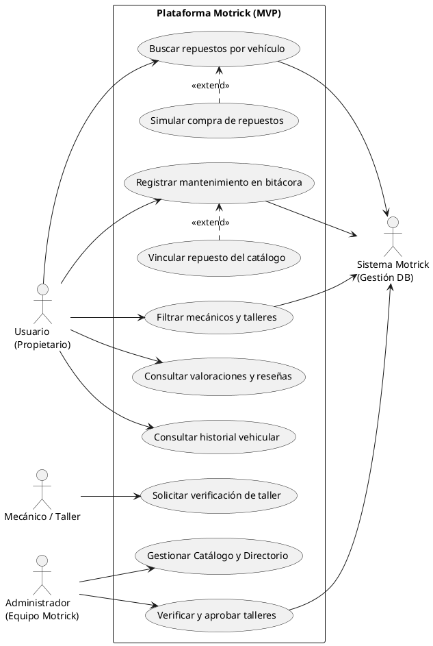

# Motrik - Modelo de Negocio, Marco Legal y Requerimientos Actualizados

**Proyecto de Aula: Ingeniería de Software**  
**Integrantes:** Alejandro David Paternina Bermejo, Johan Sebastian Brieva Fernandez  
**Docente:** Aisner  
**Fecha de Actualización:** Octubre 2026  

---

## 1. Sección 1.5: Modelo de Negocio y Marco Legal de Responsabilidad (Blindaje Jurídico)

### 1.5.1. Modelo Principal de Monetización: Directorio B2B y Membresías Freemium
Motrik adopta un modelo de monetización B2B sustentado en visibilidad, posicionamiento y membresías de servicios de valor agregado, **descartando de manera explícita el cobro de comisiones sobre las reparaciones mecánicas**.

Bajo este esquema Freemium:
* **Registro Base Gratuito:** Cualquier taller o mecánico formalmente constituido en Cartagena puede registrarse y figurar en el directorio estándar sin costo.
* **Membresías Premium y Destaque (Listing Fee / SaaS):** Los establecimientos pueden pagar una suscripción mensual o anual para:
  1. Posicionamiento prioritario en los primeros resultados de búsqueda del directorio.
  2. Insignia destacada de **"Taller Verificado"** tras auditoría documental.
  3. Panel de analíticas de visualizaciones y solicitudes de contacto.

#### Justificación Jurídica y Análisis de Riesgo (Ley 1480 de 2011 - Estatuto del Consumidor en Colombia)
1. **El grave riesgo del Modelo Transaccional (Cobro por Comisión de Reparación):**  
   Si Motrick cobrara una comisión directa por cada reparación o recaudara los pagos de mano de obra, la Superintendencia de Industria y Comercio (SIC) y los juzgados civiles podrían calificar a la plataforma como **prestador solidario del servicio**. Ante una falla mecánica, daño en el motor o incumplimiento de garantía por parte de un mecánico negligente, el propietario del vehículo podría demandar civilmente a Motrick, obligando a la plataforma a responder solidariamente con su patrimonio por daños y perjuicios.

2. **La ventaja del Modelo Directorio / Portal de Contacto (Artículo 53 de la Ley 1480 de 2011):**  
   Al operar como un directorio publicitario y canal de visualización, Motrick califica expresamente bajo el **Artículo 53 de la Ley 1480 de 2011 (Portales de Contacto e Intermediación)**. Bajo esta tipología legal:
   * La plataforma funge exclusivamente como un intermediario técnico e informativo.
   * La relación contractual de prestación del servicio mecánico se perfecciona **única y directamente entre el propietario del vehículo y el taller contratado**.
   * Motrick queda legalmente exento de responsabilidad civil por fallas técnicas, calidad de mano de obra o garantías mecánicas.

> **Cláusula de Deslinde de Responsabilidad Legal:**  
> *"De conformidad con el régimen de portales de contacto en el comercio electrónico colombiano (Ley 1480 de 2011), Motrick actúa exclusivamente como un canal de intermediación e información técnica. Los Términos y Condiciones establecen explícitamente que la plataforma no es propietaria de los talleres, no emplea a los mecánicos ni interviene en la fijación de tarifas de mano de obra. En consecuencia, la idoneidad técnica, garantías, calidad y cumplimiento del servicio recaen de manera exclusiva y directa sobre el taller contratado por el usuario."*

---

### 1.5.2. Vía Secundaria de Monetización: Publicidad Nativa y Contextual de Marca Blanca (RNF-04)
Como complemento a las membresías de talleres, Motrick incorpora espacios publicitarios pasivos integrados orgánicamente en los espacios negativos (zonas en blanco) del diseño visual de la plataforma, evitando perturbar la navegación del usuario.

A diferencia de las redes de anuncios masivas e invasivas (como Google AdSense no filtrado), Motrick opera bajo un modelo publicitario cerrado y contextual:
* **Relevancia temático-automotriz:** Solo se admiten anunciantes que aporten valor directo a la propiedad y conducción de vehículos (aseguradoras para SOAT y todo riesgo, aplicaciones de telepeaje/estacionamiento, herramientas de diagnóstico OBD2 y marcas de lubricantes/neumáticos certificados).
* **Cero intrusión (Non-intrusive UI):** Quedan terminantemente prohibidos los pop-ups, anuncios flotantes en pantalla completa, videos con autorreproducción de sonido o banners parpadeantes. Los anuncios adoptan las mismas clases tipográficas, bordes y paleta cromática del sistema de diseño (Tailwind CSS).
* **Política de Seguridad de Marca (Brand Safety Policy):** El sistema bloquea de raíz categorías inapropiadas o que degraden la seriedad técnica de la plataforma.

#### Matriz de Filtros de Contenido y Política de Anunciantes
| Categorías Aprobadas (Ecosistema Vehicular) | Categorías Estrictamente Vetadas (Blacklist) |
| :--- | :--- |
| **Servicios Financieros y Seguros:** Emisión de SOAT digital oficial, pólizas todo riesgo y financiación vehicular. | **Juegos y Entretenimiento Invasivo:** Juegos casuales, minijuegos móviles, casinos virtuales o apuestas deportivas. |
| **Aplicaciones de Movilidad y Tráfico:** Apps de pago de peajes (FacilPass, Flypass), apps de estacionamiento y navegación. | **Contenido Inapropiado / +18:** Sitios de citas, pornografía, tabaco, vapeo, alcohol o productos no aptos para menores. |
| **Tecnología y Diagnóstico:** Escáneres OBD2 Bluetooth, apps telemáticas de flotas y cámaras dashcam. | **Publicidad Engañosa / Clickbait:** Banners con alertas falsas de virus, botones engañosos de "Descargar" o criptomonedas. |
| **Insumos y Certificaciones:** Fabricantes oficiales de llantas, baterías, aceites sintéticos y Centros de Diagnóstico Automotor (CDA). | **Formatos Invasivos:** Pop-ups emergentes, interstitials bloqueantes, redirecciones forzadas o audio no solicitado. |

#### Blindaje Legal de la Publicidad (Leyes 1480 de 2011 y 1581 de 2012)
1. **Distinción Clara de Contenido (Art. 29 y 30 - Publicidad Engañosa):**  
   Para evitar inducir al consumidor a error o hacerle creer que un anuncio es una recomendación neutral del algoritmo, cada bloque publicitario lleva de forma obligatoria y visible un distintivo en tipografía pequeña (`text-[10px] uppercase font-bold text-muted-foreground`): **"Patrocinado"** junto al nombre de la marca aliada.
2. **Privacidad y Cero Rastreo Invasivo (Ley 1581 de 2012 - Habeas Data):**  
   Motrick no comercializa datos personales ni perfila al usuario mediante cookies de terceros invasivas. La publicidad es puramente **contextual**: si el usuario consulta repuestos de frenos o tiene registrado un auto con SOAT por vencer, el sistema renderiza un enlace relevante sin almacenar huellas digitales ni rastrear al usuario fuera del sitio.

---

## 2. Fichas de Requerimientos para el Documento de Aula

### 2.1. Ficha Requerimiento Funcional: RF-05
| Atributo | Detalle |
| :--- | :--- |
| **Identificador** | **RF-05** |
| **Nombre** | Verificación y validación de talleres mecánicos |
| **Descripción** | El sistema debe permitir a los talleres y mecánicos solicitar una insignia de verificación mediante el suministro de sus datos comerciales (RUT, razón social, dirección física comprobada y especialidades). El Administrador de Motrick valida la autenticidad de la información y otorga una insignia de "Taller Verificado", mejorando la visibilidad del establecimiento en el directorio. |
| **Fuente** | Elicitación: Revisión documental (desconfianza del consumidor según AAA) y Modelo de Negocio B2B. |
| **Prioridad** | Media |
| **Criterio de Aceptación** | El perfil del mecánico muestra una insignia gráfica de verificación tras ser auditado en la base de datos, y el directorio permite filtrar exclusivamente talleres que cuenten con dicho estado verificado mediante el selector "Solo verificados". |

---

### 2.2. Ficha Requerimiento No Funcional: RNF-04
| Atributo | Detalle |
| :--- | :--- |
| **Identificador** | **RNF-04** |
| **Nombre** | Visualización de publicidad nativa y contextual no invasiva |
| **Descripción** | El sistema debe disponer de componentes visuales pasivos para mostrar inserciones publicitarias contextuales (seguros, movilidad y repuestos certificados) integradas en los espacios en blanco del layout. Quedan excluidos anuncios emergentes (pop-ups), publicidad de juegos, apuestas y contenido adulto (+18). |
| **Fuente** | Modelo de negocio de la plataforma y lineamientos de experiencia de usuario (UX). |
| **Prioridad** | Baja / Media |
| **Criterio de Aceptación** | Los anuncios se renderizan como tarjetas estáticas nativas con el distintivo "Patrocinado", adaptándose al tema (claro/oscuro) sin generar desplazamientos bruscos de pantalla (Cumulative Layout Shift = 0). |

---

## 3. Sección 7.3: Matriz de Validación y Ajustes (Justificación Metodológica)

| Elemento revisado | Concepción inicial | Hallazgo de la elicitación / Negocio | Cambio realizado o justificación |
| :--- | :--- | :--- | :--- |
| **Casos de Uso (Directorio y Seguridad)** | El directorio solo permitía búsquedas pasivas sin proceso de acreditación de talleres. | Riesgo legal de garantía mecánica solidaria (Ley 1480/2011) y necesidad de generar confianza verificable según estudio AAA. | Se agregó el caso de uso *Solicitar verificación de taller* para el mecánico y *Verificar y aprobar talleres* para el Administrador, vinculando el modelo de suscripción sin asumir responsabilidad operativa. |
| **Modelo de Monetización y Publicidad** | La plataforma no contemplaba monetización secundaria ni reglas de pauta publicitaria. | Necesidad de ingresos sostenibles sin comprometer la velocidad ni la seriedad técnica de la herramienta automotriz. | Se definió la publicidad nativa contextual (RNF-04) con política de Brand Safety (veto de juegos, apuestas y +18) y tag "Patrocinado" exigido por la SIC. |

---

## 4. Diagrama de Casos de Uso Corregido (PlantUML)

---

## 5. Implementación en Código Frontend (Next.js + Tailwind CSS)

Los tres puntos solicitados ya se encuentran implementados y compilando en la aplicación:
1. **Componente Reutilizable:** [src/components/motrick/SponsoredCard.tsx](file:///c:/Users/Dell/Documents/Motrik/src/components/motrick/SponsoredCard.tsx) con tags `Patrocinado`, categorías automotrices y tema claro/oscuro.
2. **Tienda de Repuestos ([src/app/repuestos/page.tsx](file:///c:/Users/Dell/Documents/Motrik/src/app/repuestos/page.tsx)):** Espacio inferior contextual con anuncios de escáneres OBD2 y SOAT con descuento.
3. **Mi Garaje / Bitácora ([src/app/bitacora/page.tsx](file:///c:/Users/Dell/Documents/Motrik/src/app/bitacora/page.tsx)):** Espacio lateral con recordatorios de centros CDA aliados para revisión técnico-mecánica.
4. **Directorio ([src/app/directorio/page.tsx](file:///c:/Users/Dell/Documents/Motrik/src/app/directorio/page.tsx)):**
   * Filtro activo `"Solo verificados"`.
   * Botón y modal *"Soy Mecánico / Verificar Taller"* con formulario comercial (RUT, dirección y teléfono).
   * Inserción nativa de publicidad de telepeaje y movilidad.
